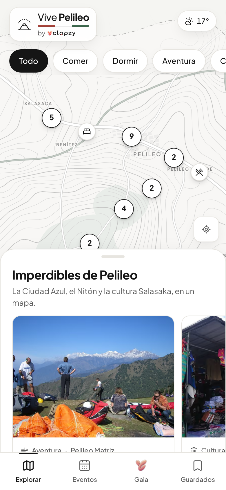
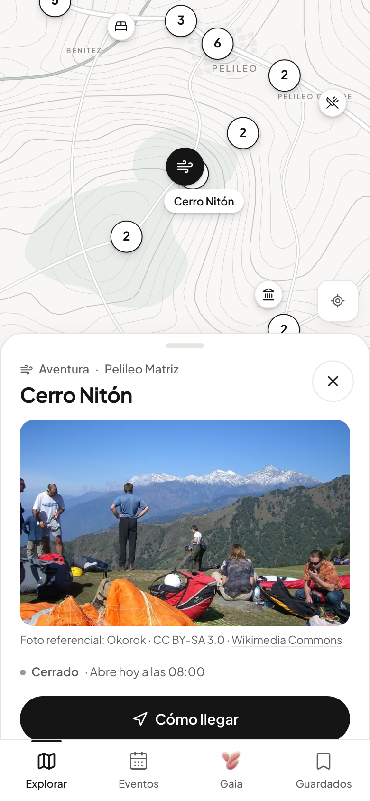
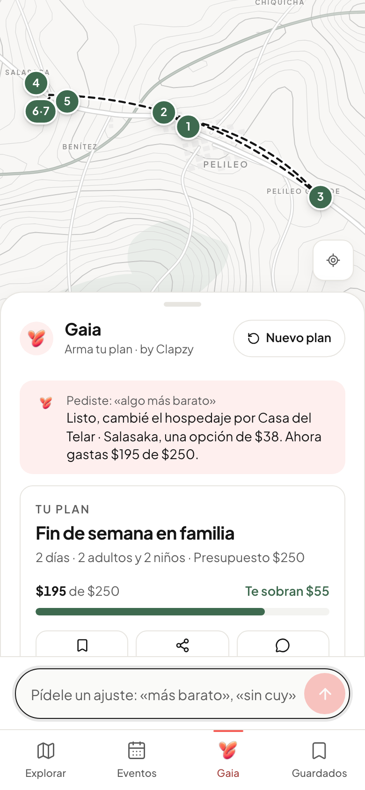
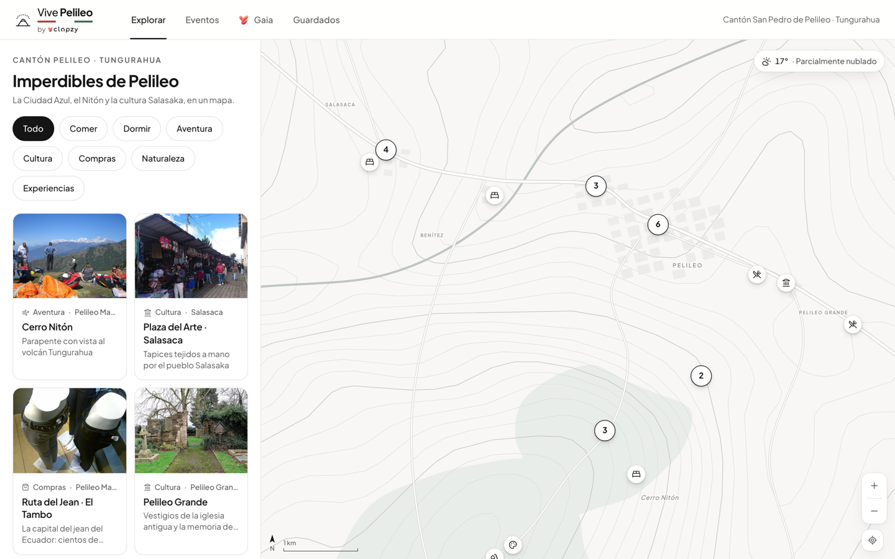
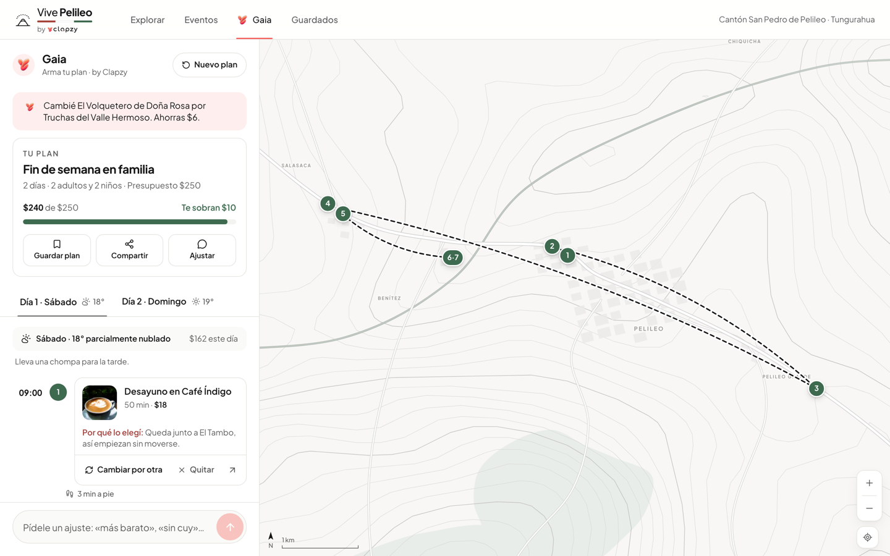
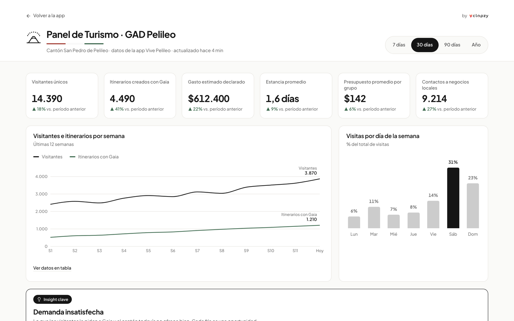

# Vive Pelileo · by Clapzy — LISTO

Demo completa, 100 % simulada (sin cuentas, APIs ni claves). Las 8 fases de `PROMPTS.md` están cerradas, cada una con su commit.

**Estado verificado al cierre**
- `npm run build`: pasa (40 páginas estáticas).
- `npm test`: 60 tests en verde (motor de Gaia).
- `npm run lint`: sin errores ni warnings.
- Sin errores de consola ni warnings de hidratación en producción, en 360, 390, 768, 1024, 1440 y 1920 px.
- El guion de la demo (BRIEF §9) corre completo con Playwright en 390 y 1440 px (`scripts/demo.mjs`).

---

## Cómo correrlo

```bash
npm install
npm run dev
```

Abre http://localhost:3000. El panel del municipio está en http://localhost:3000/municipio.

Versión de producción local:

```bash
npm run build && npm start
```

## Cómo publicarlo en Vercel

1. Sube el repo a GitHub (o GitLab/Bitbucket).
2. En vercel.com → **Add New… → Project** → importa el repo.
3. Vercel detecta Next.js solo. No hace falta ninguna variable de entorno; deja los valores por defecto (build `next build`, output `.next`).
4. **Deploy**. Cada push a `main` publica una versión nueva.

Desde la terminal también funciona: `npx vercel` (vista previa) y `npx vercel --prod`.

## Scripts útiles

| Comando | Qué hace |
|---|---|
| `npm test` | Tests del motor de Gaia (Vitest) |
| `npm run screens` | Capturas de cada ruta en 390 y 1440 px (`--base`, `--widths`, `--routes`, `--out`) |
| `node scripts/demo.mjs` | Recorre el guion de la demo con verificaciones y capturas |
| `node scripts/gaia-fuzz.mjs` | Escribe 30 pedidos variados en Gaia y verifica que siempre responda algo útil |

---

## Qué está hecho

**App pública** (mobile first, con escritorio a dos columnas)
- **Mapa propio**: ilustración SVG del cantón con curvas de nivel, ríos, vías, el Tungurahua y el límite cantonal. Tiene pan, pellizco y zoom, vuelos de cámara, clustering, pines por categoría, una ruta "costura" animada y un modo mapa de calor. Es un solo mapa persistente para Explorar, Lugar, Eventos y Gaia, así la cámara vuela entre pantallas sin recargar.
- **Explorar**: intro breve (vuelo del cantón a Pelileo), clima, filtros por categoría, carrusel de Imperdibles sincronizado con el mapa, "Esta semana" y la lista completa.
- **Detalle de lugar**: foto con crédito, si está abierto o cerrado, "Cómo llegar" (traza la ruta y da minutos y km), Guardar, "Agregar a mi plan", datos prácticos, eventos del lugar y lugares cerca.
- **Eventos**: agrupados por hoy, este fin de semana, la semana y próximos. Tienen filtros, pines en el mapa y "Agregar a mi plan".
- **Gaia** (el itinerario vive solo aquí):
  - Escenarios guionizados y un generador propio. La respuesta se ve escribiendo, con pasos de "pensando" y la ruta dibujándose en el mapa.
  - Tiene pestañas por día, "Por qué lo elegí", "Cambiar por otra", "Quitar", presupuesto en vivo, Guardar y Compartir.
  - Entiende ajustes en lenguaje natural: más barato, sin X, más aventura o más tranquilo, de noche, otro día, cambiar el hotel, agregar un lugar por su nombre y quitar lo opcional.
  - También responde preguntas de clima y costo, saluda, y explica los pedidos fuera de alcance.
- **Guardados**: lugares y planes de Gaia, con estados vacíos útiles.

**Panel de Turismo · GAD Pelileo** (`/municipio`)
- 6 KPIs, visitantes e itinerarios por semana, visitas por día, demanda insatisfecha (insight clave), mapa de calor, intenciones de Gaia, origen de visitantes, lugares más vistos y más agregados, embudo y gestión de negocios (aprobar, rechazar, deshacer).
- Formulario para publicar un evento, que aparece al instante en `/eventos`.

**Calidad**
- Accesibilidad:
  - Foco visible, enlace "Saltar al contenido" y `aria-label` en pines e íconos.
  - Objetivos táctiles de 40–44 px y contraste AA en texto.
  - Respeta `prefers-reduced-motion`; los gráficos tienen tabla de datos.
- Español neutro con "tú" en toda la interfaz (verificado también en las respuestas de Gaia).
- Fotos de Wikimedia Commons con licencia libre y créditos (`public/images/credits.json`).

## Decisiones principales (detalle en `DECISIONES.md`)

- **El itinerario es de Gaia**: no hay sección de itinerario aparte. "Agregar a mi plan" en lugares y eventos lleva a Gaia, que suma la parada al plan actual o arma uno nuevo que la incluye.
- **Amigable para todas las personas**: textos cortos, acciones grandes, Gaia nunca queda en blanco y explica lo que no puede hacer (por ejemplo, el parapente no es apto para niños).
- **Mapa con d3-zoom y pines en HTML**: se posicionan con variables CSS, sin re-render, para que los vuelos sean fluidos en mobile. Las paradas cercanas se separan en pantalla para no encimarse.
- **Gaia**:
  - Los escenarios guionizados solo se usan si el pedido coincide; si no, arma el plan el generador determinista.
  - Tope de 3 días ("Pelileo se disfruta bien en 3 días").
  - Con presupuesto muy bajo, solo propone lugares gratuitos y lo explica.
- **Persistencia**: guardados en `localStorage` y conversación, plan y eventos publicados en `sessionStorage`, siempre dentro de try/catch.
- **Paleta de los gráficos**: es casi neutra por marca (no pasa el piso de croma del validador). Lo compenso con leyenda, etiquetas directas y tabla.
- **Coral de Clapzy** muestreado del logo (`#F45C55`). Next 16 sin `cacheComponents`, porque mantenía páginas ocultas con un mapa persistente.

## Pendiente / ideas para después

- Algunas fotos son **referenciales** (tipo de lugar, no el lugar exacto). Conviene reemplazarlas por fotos propias del GAD o de los negocios.
- Los datos de lugares, eventos y del panel son **simulados**. El siguiente paso sería conectarlos a una fuente real (CMS del municipio o una API).
- Gaia es un motor de reglas, no un modelo de lenguaje. Frases como "empezar más tarde" todavía reciben una sugerencia genérica en vez de un ajuste. Conectarlo a Claude daría conversación libre real.
- El selector de período del panel es visual: los datos siempre son de 30 días.
- En el mapa, el pin seleccionado puede tapar parcialmente un pin vecino muy cercano (por ejemplo, Cerro Nitón y su café).
- No hay modo oscuro, porque el brief no lo pedía.
- `/dev/mapa` sigue publicado como banco de pruebas del mapa (lo pide la fase 1). Se puede borrar antes de compartir el link.

---

## Capturas

| | |
|---|---|
|  |  |
| Explorar · mobile | Detalle de Cerro Nitón · mobile |
|  |  |
| Gaia ajusta "algo más barato" · mobile | Explorar · escritorio |


*Gaia · plan familiar después de "Cambiar por otra" en el almuerzo*


*Panel de Turismo · GAD Pelileo*
